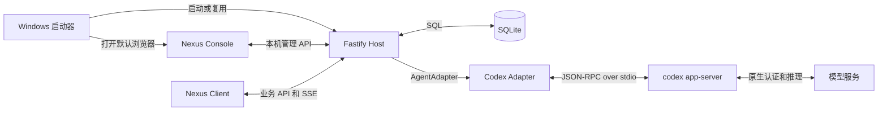

# Namica Nexus V0.1 架构

V0.1 部署在个人 Windows PC 上。一个 Host 进程持有本地业务数据和正在执行的任务。Web Client 可以断开重连；每轮 Codex 子进程退出后，下一轮用新进程恢复原生线程。模型推理使用 Codex 已配置的原生服务。启动、登录与配置示例见 [README](../README.md)。

## 模块边界

| 路径 | 职责 |
| --- | --- |
| `apps/web` | React/Vite 的 Client 与 Console 两个入口。Client 管理身份和对话，订阅业务事件。Console 读取本机管理状态、配置 Runtime 并可显式请求停止 Host。 |
| `scripts/windows` | 从源码构建 Windows 启动器，协调同一端口的启动请求，核对本机实例就绪状态并打开 Console。 |
| `packages/protocol/src/index.ts` | Host 与 Web 共用的 HTTP 响应、快照和 SSE 通知类型。 |
| `apps/host/src/main.ts` | 监听回环接口，接收关闭信号，启动和停止 Host。 |
| `apps/host/src/app.ts` | 路由、Zod 输入校验、静态 Web 托管、Host 配置、Runtime 检测、SSE 发布。 |
| `apps/host/src/tasks.ts` | 将业务会话交给 Adapter，记录回复和工具事件，管理超时、取消和待审批请求。 |
| `apps/host/src/store.ts` | 使用 Node 的 SQLite 驱动管理事务、人格快照、平台与 Runtime 会话映射和异常恢复。 |
| `packages/agent-core/src/index.ts` | 定义 `AgentAdapter`、`AgentRun` 和事件联合类型。一个 run 对应一个 Turn。 |
| `packages/agent-codex/src` | 启动和关闭 Codex，处理 stdio 协议、线程恢复、原生工具及审批。 |

Host 通过 `adapterFactory(runtime)` 选取 Adapter。Adapter 在 `run(input, publish)` 中同步返回可取消的句柄，并通过 `done` 交付最终结果。Host 使用平台事件；Codex 协议的字段转换集中在 Adapter 内。当前内置一种 Runtime 配置，新增产品时应补充对应工厂、配置来源及能力验证。

## 数据和身份

Host 相对于启动工作目录解析 `data/`，也可由 `NEXUS_DATA_DIR` 覆盖。目录下的 `nexus.sqlite` 保存业务数据和设置，`workspace/` 是默认工作区，`codex-home/` 是独立的官方 Codex 配置、原生线程、数据库和日志目录。整个默认数据目录由 Git 忽略。SQLite 使用外键、WAL 与独占连接；每个数据目录同一时间只允许一个 Host 写入并进行启动恢复。

默认工作目录在库中保存为继承标记，运行时相对于当前数据目录解析，所以可随目录一起搬迁。启动时以事务修正旧版写入的已知默认绝对路径。用户指定的外部工作区继续使用绝对路径。

| 表 | 标识和关键内容 |
| --- | --- |
| hostConfig、runtimes | 保存 Host 配置及 Runtime 的启用状态、可执行文件、默认模型、工作区和最近一次可用性检测。进程状态根据活动任务计算。 |
| identities | 永久 UUID、名称、描述、头像、人格文本及版本、Runtime 配置、默认工作区和时间。更改注入指令用到的名称、描述、人格会增加版本。 |
| sessions | 平台会话 ID、identityId、runtimeConfigId、第三方 runtimeSessionId、人格版本、指令快照、工作区路径（空串表示随数据目录解析的默认工作区）、标题、状态和时间。 |
| turns | 每次发送的 UUID、所属会话、执行状态和失败原因。部分唯一索引约束每个会话只能有一个 running Turn。 |
| messages | 用户原文及助手正文分别存储，包含所属会话与 Turn、角色、时间、状态和会话内唯一 sequence。流式阶段持续更新同一条助手消息。 |
| tools | Turn 内的工具项 ID、描述、状态、可用的执行结果摘要。 |

新建会话时捕获指令与工作区，不传标题时首条消息的首行会成为标题（上限 40 个 Unicode 码点）。不同身份或会话拥有独立的 Runtime 线程。工作区是文件系统目录，两个会话指向同一目录时会看到相同文件；需要隔离文件时给身份指定不同目录。

## 一次对话

1. 客户端发送消息。Host 读取 Runtime 配置，在事务中插入 Turn、用户原文、助手消息占位并更新会话状态。事务提交后调用 `adapter.run` 启动后台执行，路由返回 HTTP 202。响应表示请求已受理，最终结果从快照读取。
2. Host 把会话指令、工作区、本次消息和已有的 Runtime 线程 ID 交给 Adapter。每个 Turn 启动一个独立的 App Server；首轮创建线程，后续轮次恢复已有线程。Host 持久化返回的线程映射。Codex 使用自身的会话上下文。
3. Adapter 将增量文本汇集为当前回复，Host 更新 SQLite 后通知客户端。工具结果与当前 Turn 关联。审批请求只存在于活动 run 中，刷新网页可通过快照读取仍有效的请求。
4. 用户的同意或拒绝经 Host 送回同一会话的 Adapter，许可仅针对该次请求。Adapter 拒绝无法安全展示的请求。用户取消或超时会触发 Runtime 中断，网页断开只会移除 SSE 订阅。
5. 结束时，Host 在同一事务中记录 Turn、助手消息和 Session 的最终状态，未结束的工具标为 interrupted。Runtime 失败保留已收到的文本与错误摘要。

| 状态 | 含义 |
| --- | --- |
| idle | 会话尚未运行。 |
| running | Host 已接受消息，正在准备或执行。 |
| completed | Runtime 确认完成。 |
| cancelled | 取消已确认，或 Adapter 已终止执行。 |
| failed | 启动、线程恢复、通信、运行或执行超时失败。 |
| interrupted | 正常关停期间的活动任务，或重启后发现的遗留 running 记录。 |

下次发送会沿已有映射请求恢复。原生线程不存在时保留旧聊天记录，并通过失败的 Turn 展示 Runtime 错误。已终止的审批不会在重启后接受旧响应。

## 接口与重连

下表路径相对于 `/api`。本机管理端点集中在 `/api/manage`。两类接口共用一个 Host、Store 和 Tasks，当前都只在回环地址提供。列表响应是 JSON 数组。校验错误为 400，资源缺失为 404，同会话并发发送、过期审批等冲突为 409。错误响应使用 `{"error":"…"}`。

| 方法 | 路径 | 输入或返回 |
| --- | --- | --- |
| GET | /manage/host/status、/manage/host/config | 服务标识、实例状态、活动 Turn 数、运行时长、数据目录及持久配置。 |
| PATCH | /manage/host/config | 日志等级、执行超时、默认 Runtime。 |
| POST | /manage/host/shutdown | Console 发送用户确认时的 `instanceId` 和 `activeTurns`。两者任一变化返回 409，请求方需重新确认。202 表示 Host 已受理。本机调用方也可用空 JSON 对象显式请求关停。 |
| GET、PATCH | /manage/deployment | 读取当前与下次启动设置，保存本机监听地址、端口及目标数据目录。 |
| POST、GET | /manage/host/restart、/manage/host/restart-result/:id | 确认活动任务数、实例与待应用设置后重启。原页面通过有时效的回执确认新实例或回退结果。 |
| GET、POST | /manage/auth/codex、/manage/auth/codex/login、/manage/auth/codex/cancel、/manage/auth/codex/logout | 读取 Nexus 专用账号状态，发起官方授权、取消授权及退出。等待确认的授权会话由 Host 持有。 |
| GET | /manage/logs、/manage/directories | 查询当前实例最近的诊断事件，或由用户逐级浏览本机目录。 |
| GET | /manage/runtimes | 供 Console 与本机登录辅助命令读取部署配置。 |
| PATCH、POST | /manage/runtimes/:id、/manage/runtimes/:id/check | 保存配置或启动真实可用性检查，返回 Runtime。 |
| GET | /runtime-options、/identities | Client 的 Runtime 选项（ID、类型、启用状态、是否默认）和身份列表。 |
| POST、PATCH | /identities、/identities/:id | 创建或更新身份，返回 Identity。 |
| GET、POST | /sessions | 查询（可带 identityId）或用 identityId 与可选 title 创建会话。 |
| GET | /sessions/:id | 返回 session、messages、turns、tools、approvals 组成的快照。 |
| GET、POST | /sessions/:id/messages | 获取有序消息，或提交带 content 的消息并返回 Turn。 |
| POST | /sessions/:id/cancel | 取消当前 Turn。 |
| POST | /sessions/:id/approvals/:approvalId | decision 可选 accept 或 decline。 |
| GET | /events | EventSource 长连接与心跳。 |

SSE 通知浏览器哪些资源需要重新读取，例如 `{"type":"session.changed","sessionId":"…"}`。同一资源的突发通知可合并。浏览器在连接建立或恢复时查询快照，按 sequence 展示有序消息。快照包含 SQLite 中的正文和工具状态，以及当前活动任务内存中的待审批项。随着聊天历史增长，整会话查询与逐次写入的成本会增加，可按实际规模引入分页和增量传输。

## 配置生效时间

| 配置 | 生效时间 |
| --- | --- |
| 日志等级 | 保存后立即应用。 |
| 执行超时 | 新提交的 Turn 读取。 |
| Host 默认 Runtime | 创建身份且省略 runtimeConfigId 时采用。 |
| 人格、身份工作区、Runtime 绑定 | 新建会话时捕获。默认工作区可随数据目录搬迁。 |
| Runtime 默认工作区 | 新建会话时，身份工作区留空才继承。 |
| Runtime 的启用、可执行文件、模型与代理 | 后续调用读取。已保存的代理用于专用登录、检测和 Turn；清空后沿用进程环境及支持的系统代理。活动 Turn 或检测期间改配返回 409。 |
| 监听地址、端口、数据目录 | 启动环境选择初始部署。Console 保存的设置在下一次启动或显式重启后生效。 |

## 本地访问边界

每个 Host 的 Codex 工厂绑定该数据目录的 `codex-home`。启动子进程时设置其私有 `CODEX_HOME`、SQLite 与日志位置，并在 RPC 握手后核对实际值。首次登录使用同一目录和代理的官方 CLI；切换前的线程映射从专用库恢复失败时向用户提示新建会话。日常 Codex 的旧列表保留原貌。详见 [原生线程存储决策](adr/003-private-codex-home.md)。

Host 校验 Host、Origin 和浏览器跨站请求标记，仅监听 `127.0.0.1` 或 `::1`。开发模式额外识别本机 Vite 来源。跨地址重启时，原页面凭有时效的随机回执查询结果，再携回执导航至新 Console。新页面加载后从地址栏清除回执。业务接口和其他管理接口继续使用原本的来源限制。Codex 管理凭据，Console 展示登录状态及本次官方授权所需的信息。Host 日志通过固定事件字段进入有限的内存缓冲区。单用户本机进程属于信任边界，远程客户端和设备认证属于后续版本。[Host 与 Adapter](adr/001-host-and-adapters.md) · [本地存储](adr/002-local-storage.md)

## 所有权与扩展边界

平台以 `identityId` 关联人格、会话历史及未来的私有记忆。更换模型服务账号、升级模型或替换 Runtime 时，Host 保留这些数据及其原有归属。[平台标识与会话连续性](adr/002-local-storage.md)

| 概念 | 归属与生命周期 |
| --- | --- |
| AI Identity（平台身份） | Host 生成稳定的 UUID。同一身份可以更名、修改人格或选择其他 Runtime，仍可通过原 ID 找回它的会话。 |
| Personality（人格） | 使用者为身份设定的人格由 Host 保存。当前身份记录持有最新文本和版本，新会话保存当时的指令快照。只有版本号时无法还原每次编辑的旧文本。 |
| Memory（长期记忆） | 长期设计由 Host 按身份管理私有记忆，并关联形成记忆的证据。共享经历须有明确的共享范围。V0.1 已保存原始会话历史，长期记忆提取与检索属于后续能力。 |
| Runtime（执行环境） | 会话绑定 Runtime 配置，Adapter 调用对应的推理与工具能力并转换原生协议。模型可以升级或更换。Host 当前尚未记录每个 Turn 实际使用的模型或二进制版本。 |
| Authentication（模型服务认证） | 账号和授权仅用于取得模型服务访问资格。当前由官方 Codex 在 Nexus 专用目录管理登录，多个平台身份可以使用同一份授权，各自保有人格与历史。授权失效时可在同一目录重新授权。[独立授权决策](adr/003-private-codex-home.md) |
| Session / 原生 Thread | Host 以平台 UUID 组织多轮消息，首次获得原生 ID 时保存映射。Codex 保存推理所用的原生上下文。平台可以展示历史；原生线程丢失时旧会话的下一轮会报告恢复失败。 |
| Workspace / Policy | 多个身份可共享同一工作目录。原生沙箱与人工单次审批约束本轮操作。待审批请求在内存里，Host 尚无按身份分配的独立策略、预算或持久审批账本。 |

`agent-core` 的事件已经隔离原生 RPC。当前生产工厂只分派 Codex，SQLite 只初始化一条 Runtime 配置，API 可编辑既有配置。接口声明的 resume、stream、cancel、approvals 四个能力标志尚未驱动 Host 调度或界面行为。现有注入工厂验证了同一调用方能用测试替身；能否接纳不同恢复或审批语义，需要第二个真实产品验证。

原生线程无法恢复时，V0.1 保留历史和失败状态，用户可为同一身份新建会话。未来应考虑由 Host 选择该身份的人格、相关历史和有权使用的长期记忆，为新的原生线程重建上下文。重建后应能区分原线程与新线程，保留既有工具执行结果。上下文选择和重建时机见[待讨论事项](architect/open-questions.md)。关系、记忆检索、事件调度和多端访问的目标见[愿景](vision.md)。

## Windows 启动和关闭

双击启动器启动或复用目标 Host，就绪后打开 `/console/`。聊天 Client 保留在 `/`。关闭任一网页都会保留后台任务；Console 的显式关停和命令行退出由 Host 处理，活动任务和未结束的工具记为中断。地址、数据目录与本机实例的关系及验收范围见 [ADR 004](adr/004-windows-launch-and-shutdown.md) 和 [TASK-001](tasks/TASK-001-windows-launch-and-shutdown.md)。

启动配置保存在数据树外。默认使用安装目录下由 Git 忽略的 `.nexus-deployment/`，可用 `NEXUS_DEPLOYMENT_FILE` 显式选择配置文件。数据目录迁移时，Host 先释放运行句柄并锁定源数据库，再将副本暂存到空目标内，验证并调整平台工作区及受支持的 Codex 线程索引，最后启用新配置。目标不可用时尝试恢复原设置。源码或依赖更新需停止再启动，以便新 Node 进程加载代码。[Console 运维验收](tasks/TASK-002-console-operations.md)
